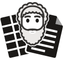
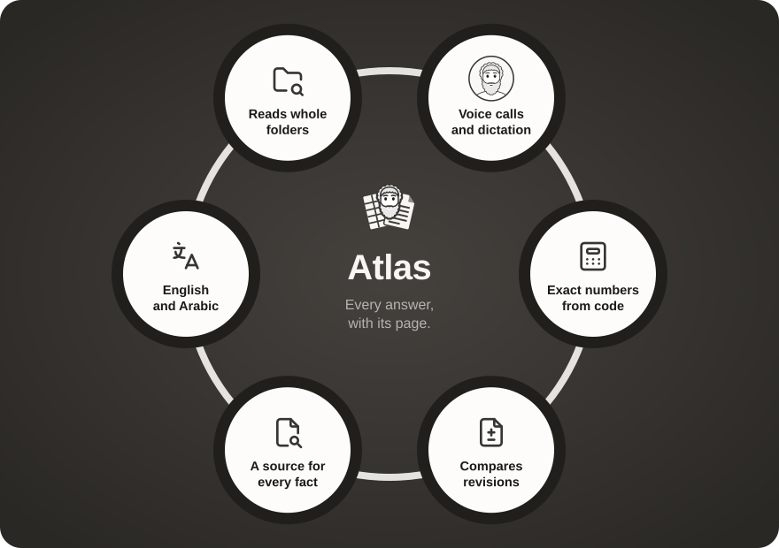
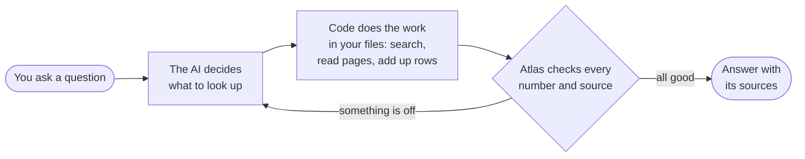

  <picture>
    <source media="(prefers-color-scheme: dark)" srcset="docs/images/logo-dark.svg">
    
  </picture>

<h1 align="center">Atlas</h1>

<b>Ask your project documents a question. Get an answer you can check.</b>

Atlas reads a folder of PDFs and Excel files (contracts, bills of quantities, specifications, meeting minutes) and answers questions about them in English or Arabic. Every answer shows where it came from, down to the page or the spreadsheet row.

## Contents

1. [What Atlas does](#what-atlas-does)
2. [Check every answer](#check-every-answer)
3. [Talk to Atlas](#talk-to-atlas)
4. [Pick the AI model](#pick-the-ai-model)
5. [How it works](#how-it-works)
6. [Tech stack](#tech-stack)
7. [Run it yourself](#run-it-yourself)
8. [Good to know](#good-to-know)

## What Atlas does

## Check every answer

Click a source and the PDF opens at the right page, with the sentence highlighted. A spreadsheet opens with the rows the answer used marked.

## Talk to Atlas

Press the phone button and talk to Atlas as you would on a call, in English or in your own Arabic dialect.

- **English and five Arabic dialects** (Gulf, Levantine, Egyptian, North African, Modern Standard), female or male.
- **Pick the voice** from the arrow beside the call button.
- **Checked answers.** The voice reads out the checked answer and never works out numbers itself.
- **Prefer typing?** The microphone button turns speech into a question you can edit before sending.

## Pick the AI model

Pick the model, and how long it thinks, from the top bar. Each answer shows what it cost and how long it took.

| Model | Best for | Cost |
| --- | --- | --- |
| GPT-6 Luna | Everyday questions | Lowest |
| GPT-6.1 Sol | A balance of depth and cost | Medium |
| GPT-6 Astra | The hardest questions | Highest |

### Or use it for free

| Free option | How to set it up | Good to know |
| --- | --- | --- |
| Gemini's free tier | Get a key at [aistudio.google.com/apikey](https://aistudio.google.com/apikey) and add `GEMINI_API_KEY=` to `.env` | Daily limit. Google may use what it is sent, so keep confidential files off it |
| A model on your computer | Install [Ollama](https://ollama.com), then run `ollama pull qwen3:14b` (`qwen3:8b` on a 16 GB Mac) and `ollama pull bge-m3` | Nothing leaves your computer. Needs a graphics card with 6 GB or more, or a Mac with Apple silicon and 16 GB or more |

Free models sit in the same picker. Voice calls still use OpenAI.

## How it works

An AI model and ordinary code share the work. The model reads your question and decides what to look up. Code does the looking up: it searches the files, reads pages and adds up table rows. The model then writes the answer from what the code found. Before you see it, Atlas checks that every number in the answer appears in those results and that every source points to a real page or row. An answer that fails goes back to the model to fix.

A voice call takes the same path: the voice only listens and speaks, and the question it hears is answered and checked like a typed one.

### In the code

Each step has its own chart in [docs/TECHNICAL.md](docs/TECHNICAL.md).

## Tech stack

| Part | Built with |
| --- | --- |
| Web app | React, Vite, Mantine, TypeScript |
| Server | Node.js 24, Fastify, TypeScript |
| AI | OpenAI: GPT-6 models for answers, GPT-Live for voice calls, gpt-transcribe for dictation, text-embedding-3-small for search by meaning. Free instead: Gemini (Google's free tier) or a local model through Ollama |
| Reading files | mupdf for PDFs, exceljs for Excel |
| Storage | SQLite on your computer, one file per folder, with keyword search |
| Data shapes | Zod, shared by the server and the web app |
| Tests | Vitest: about 1,890 tests that need no key and no network |

## Run it yourself

| Step | Windows (PowerShell) | macOS / Linux |
| --- | --- | --- |
| 1. Install Node.js 24 | [nodejs.org](https://nodejs.org/en/download) | [nodejs.org](https://nodejs.org/en/download) |
| 2. Switch on pnpm | `corepack enable` | `corepack enable` |
| 3. Get the code | `git clone https://github.com/MoSmeha/Atlas.git; cd Atlas` | `git clone https://github.com/MoSmeha/Atlas.git && cd Atlas` |
| 4. Install | `pnpm install` | `pnpm install` |
| 5. Add a model key | `Copy-Item .env.example .env`, then set `OPENAI_API_KEY=`, or `GEMINI_API_KEY=` to use it free | `cp .env.example .env`, then set `OPENAI_API_KEY=`, or `GEMINI_API_KEY=` to use it free |
| 6. Start | `pnpm dev`, then open http://localhost:5173 | `pnpm dev`, then open http://localhost:5173 |

A sample project, a fictional tower in Riyadh, loads by itself. To use your own files, click the folder button in the sidebar and choose a folder, type its path, or drop files on the sidebar.

## Good to know

- **Your files stay on your computer.** Only the passages and page images the AI needs go to OpenAI or Google; with Ollama, nothing leaves.
- **Cost.** Under a cent a question on Luna, $0.05 a minute on calls; free models cost nothing.
- **File types.** PDF and Excel (`.xlsx`, `.xlsm`); other files are listed and skipped.
- **Licence.** No permissive licence, because mupdf is AGPL-3.0.
- **For developers.** [docs/TECHNICAL.md](docs/TECHNICAL.md) (settings, tools, layout, tests), [docs/NOTE.md](docs/NOTE.md) (design notes), [docs/TIMELOG.md](docs/TIMELOG.md) and [client/DESIGN.md](client/DESIGN.md).
