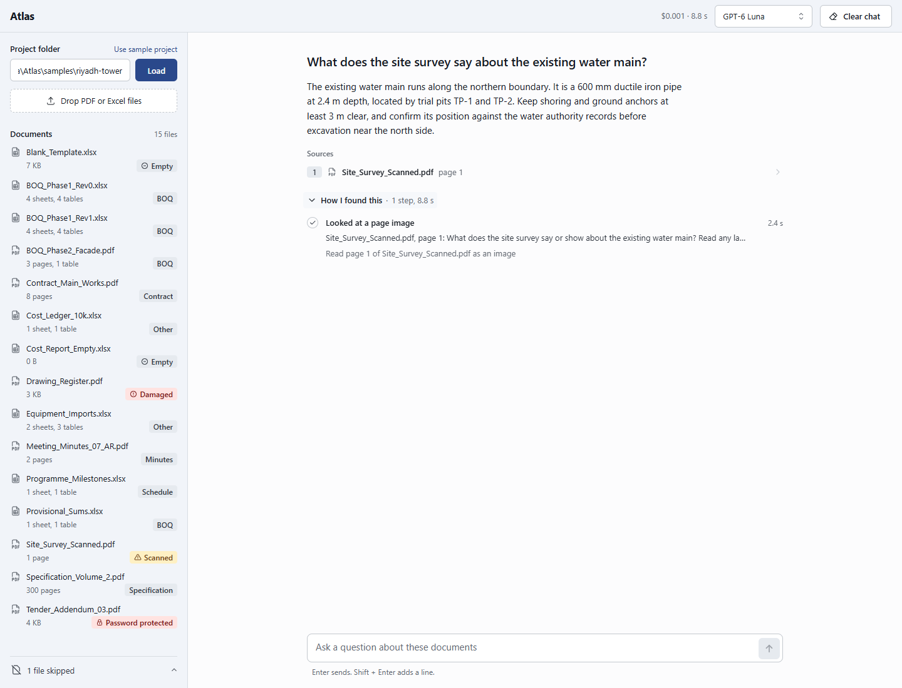
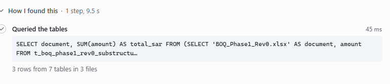
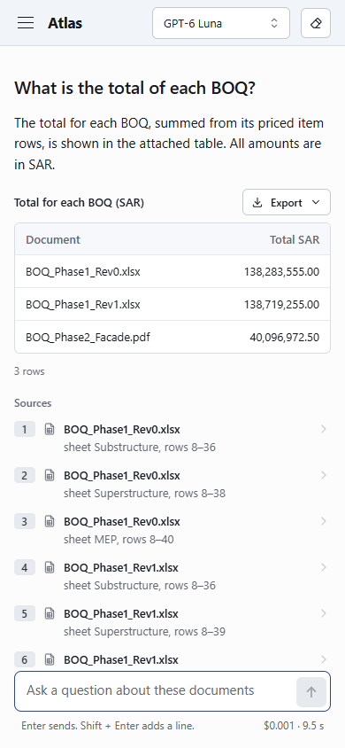
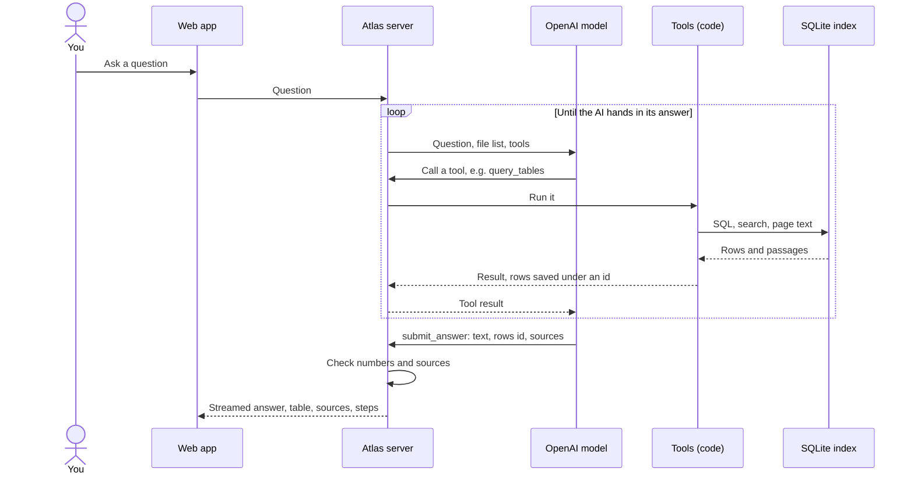
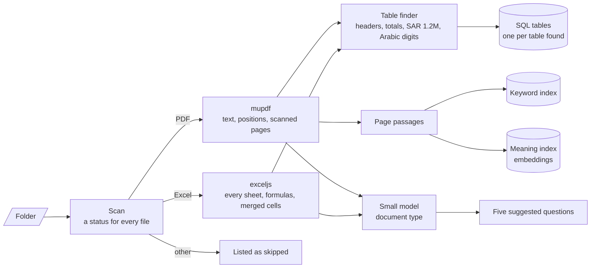
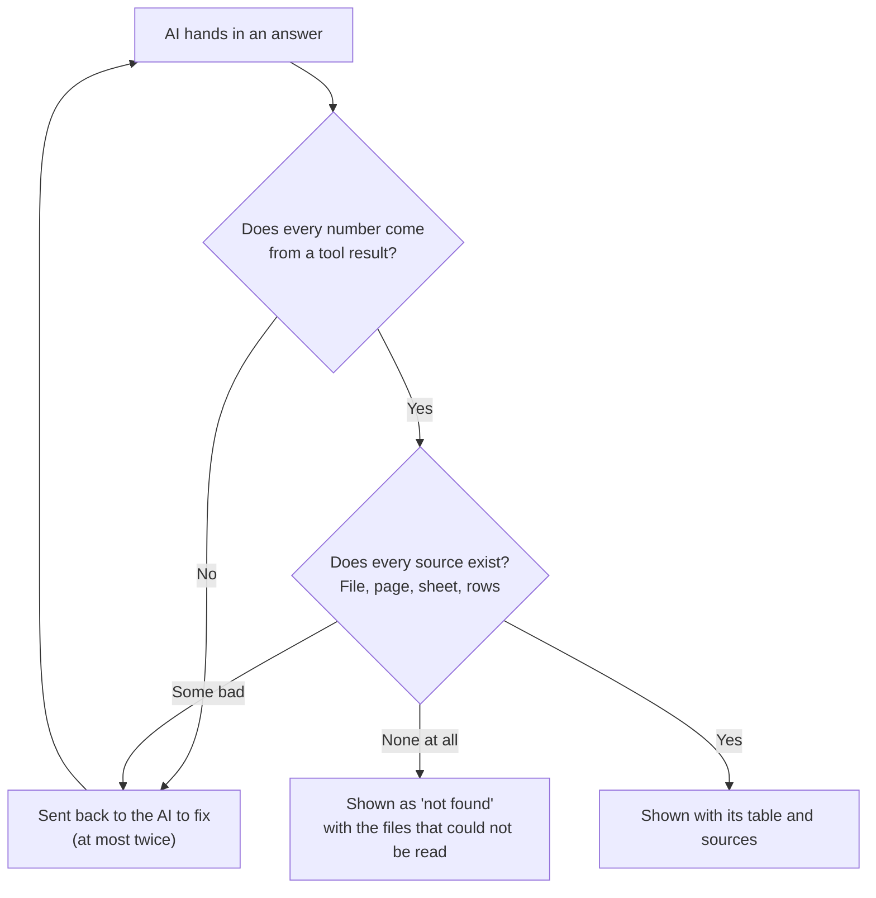
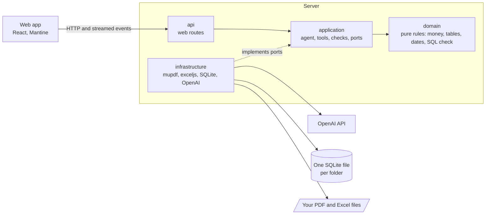
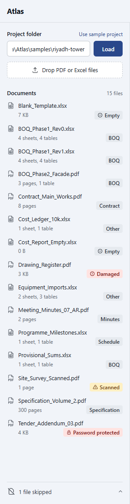
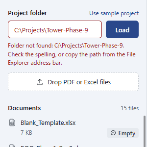
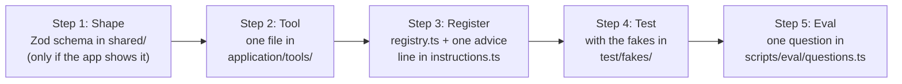

# Atlas

Ask questions about a folder of project documents, PDF and Excel, in English or Arabic. Every answer shows its sources. Totals and lists are worked out by code over every row, not typed by the AI.


## Run it

| Step | Windows (PowerShell) | macOS / Linux |
| --- | --- | --- |
| 1. Install Node.js 24 | [nodejs.org](https://nodejs.org/en/download) | [nodejs.org](https://nodejs.org/en/download) or `brew install node@24` |
| 2. Switch on pnpm | `corepack enable` | `corepack enable` |
| 3. Get the code | `git clone https://github.com/MoSmeha/Atlas.git; cd Atlas` | `git clone https://github.com/MoSmeha/Atlas.git && cd Atlas` |
| 4. Install | `pnpm install` | `pnpm install` |
| 5. Add your OpenAI key | `Copy-Item .env.example .env`, then set `OPENAI_API_KEY=` | `cp .env.example .env`, then set `OPENAI_API_KEY=` |
| 6. Start | `pnpm dev`, then open http://localhost:5173 | `pnpm dev`, then open http://localhost:5173 |

The sample project `samples/riyadh-tower` loads by itself. To use your own files, type a folder path in the sidebar or drop files on it.

From the command line: `pnpm cli samples/riyadh-tower "What is the total of each BOQ?"`

## What it does

<table>
  <tr>
    <td width="50%"><br><b>Load a folder.</b> Every file is listed with its type, and Atlas suggests questions that fit.</td>
    <td width="50%"><br><b>Exact rows.</b> "Above SAR 1 million" is a database query over every row. Export the rows to Excel or CSV.</td>
  </tr>
  <tr>
    <td><br><b>Open a source.</b> A PDF opens at the cited page, with the sentence highlighted.</td>
    <td><br><b>Or the sheet.</b> A spreadsheet opens at the cited rows.</td>
  </tr>
  <tr>
    <td><br><b>Arabic in, Arabic out.</b> Answers read right to left. File names and numbers are kept as written.</td>
    <td><br><b>Scanned pages.</b> A page with no text is shown to the AI as an image.</td>
  </tr>
  <tr>
    <td><br><b>Compare revisions.</b> Items added, removed and changed, and the change in total.</td>
    <td><br><b>No guessing.</b> When the documents don't say, Atlas says so and names the files it could not read.</td>
  </tr>
  <tr>
    <td><br><b>How I found this.</b> Every step Atlas took, with its time.</td>
    <td><br><b>Phone width.</b> The same app on a narrow screen.</td>
  </tr>
</table>

## How it works

### A question becomes an answer



### What happens when a folder loads



A watcher re-reads a file as soon as it is added or changed. The index is cached per folder, so loading a folder again takes milliseconds.

### Every answer is checked before you see it



### How the code is arranged



## Tools

The AI decides which tools to call. The tools are code: the AI asks, and the code does the work.

| Tool | Job |
| --- | --- |
| `list_documents` | Every file: its status, type, pages or sheets, tables and currencies |
| `search_documents` | Finds passages by exact words and by meaning |
| `read_pages` | Exact text of a range of PDF pages |
| `query_tables` | One read-only SQL query over every loaded table |
| `look_at_page` | Shows a page image to the AI, for scanned pages and drawings |
| `check_boq_arithmetic` | Quantity × rate against the amount, and subtotals against their rows |
| `extract_schedule` | Dates, deadlines, durations and deliverables, Hijri dates included |
| `compare_revisions` | Two BOQ revisions: items added, removed and changed |
| `calculate` | Safe arithmetic on numbers the tools returned |
| `export_table` | Saves a result as `.xlsx` or `.csv` |
| `submit_answer` | Hands in the answer, which is then checked as shown above |

## Edge cases

<table>
  <tr>
    <td width="300"></td>
    <td>

| Case | What Atlas does | Sample |
| --- | --- | --- |
| Damaged PDF | Listed as **Damaged** | `Drawing_Register.pdf` |
| Password-protected PDF | Listed as **Password protected** | `Tender_Addendum_03.pdf` |
| 0-byte Excel file | Listed as **Empty** | `Cost_Report_Empty.xlsx` |
| Workbook with only empty sheets | Listed as **Empty** | `Blank_Template.xlsx` |
| Scanned PDF | Listed as **Scanned**, read as an image | `Site_Survey_Scanned.pdf` |
| Word file | Listed as **skipped** | `Cover_Letter.docx` |
| 300-page PDF | Search finds the right pages; only those are read | `Specification_Volume_2.pdf` |
| 10,000-row sheet | All rows in SQL; counts and totals cover every row | `Cost_Ledger_10k.xlsx` |
| BOQ running over PDF pages | One table; carried-forward lines are not items | `BOQ_Phase2_Facade.pdf` |
| Header under title rows, merged headers | Real header found, headers joined | `BOQ_Phase1_Rev0.xlsx` |
| Two tables on one sheet | Split, each with its own currency | `Equipment_Imports.xlsx` |
| "SAR 1.2M", Arabic-Indic digits | Read as plain numbers | `Provisional_Sums.xlsx` |
| Several currencies | Never added together; one total per currency | `Equipment_Imports.xlsx` |
| Arabic PDF | Read in the right order; Arabic questions answered in Arabic | `Meeting_Minutes_07_AR.pdf` |
| English question, answer only in Arabic | Found by meaning, answered in English | `Meeting_Minutes_07_AR.pdf` |
| Two revisions of a BOQ | Compared row by row | `BOQ_Phase1_Rev0/Rev1.xlsx` |
| Question not in the documents | "Not found", with the unreadable files named | Any off-topic question |
| A document that orders the AI around | Treated as text; the real contract value is given | `Specification_Volume_2.pdf` p. 297 |
| Empty folder, wrong path | A clear message in the sidebar (below) | `samples/empty-folder/` |

</td>
  </tr>
</table>



Every sample document is fictional. `samples/README.md` describes each file, and `samples/expected.json` holds the right answers.

## Settings

Settings live in `.env`. Only the key is required.

| Name | Default | What it means |
| --- | --- | --- |
| `OPENAI_API_KEY` | none | Your OpenAI key |
| `ATLAS_FOLDER` | `samples/riyadh-tower` | Folder loaded at start |
| `PORT` | `3001` | Server port; the web app forwards to it |
| `ATLAS_DATA_DIR` | `.atlas` | Index cache and uploads |
| `ATLAS_LOG_DIR` | `.logs` | One log line per tool call and question |
| `ATLAS_EXPORTS_DIR` | `exports` | Exported `.xlsx` and `.csv` files |
| `ATLAS_MAX_FILE_MB` | `200` | Larger files are listed as too large |
| `ATLAS_MAX_ROUNDS` | `12` | Tool rounds before the AI must answer |

**Models** are set in `server/config/models.json`.

| Tier | Model | Used for |
| --- | --- | --- |
| small | GPT-6 Luna | **Default for answers** (cheap), sorting documents into types, confirming dates |
| balanced | GPT-6.1 Sol | Picker option |
| frontier | GPT-6 Astra | Picker option for the hardest questions |

Atlas keeps only the models your key can see; `pnpm models` lists them. Change `answerTier` to change the default.

## Project layout

```text
shared/    Data shapes used by server and web app (Zod)
server/    src/domain        pure rules
           src/application   agent, tools, checks, ports
           src/infrastructure mupdf, exceljs, SQLite, OpenAI
           src/api           web routes
           config/           models.json
           scripts/          samples, eval, models
           test/             tests, with fakes for every port
client/    web app (React, Vite, Mantine), DESIGN.md
samples/   fictional documents and their right answers
docs/      images, eval report, note, time log
```

## Tests and eval

| Command | What it does |
| --- | --- |
| `pnpm test` | About 1,650 unit tests. No key, no network |
| `pnpm typecheck` | Types in all three packages |
| `pnpm eval` | 21 real questions checked against `samples/expected.json`; writes [docs/EVAL.md](docs/EVAL.md). Costs a few cents on Luna |
| `pnpm samples` | Rebuilds the sample documents (needs Microsoft Edge) |

**Latest eval:** 21 of 21 passed on GPT-6 Luna, with a median answer time of 6.9 seconds and **$0.02 for all 21 questions**. Every answer's time, cost and check is in [docs/EVAL.md](docs/EVAL.md).

## Add a tool



<details>
<summary>A tiny example tool and its test</summary>

```ts
// server/src/application/tools/pageCount.ts
import { z } from 'zod';
import { defineTool, ToolError } from './Tool';

export const pageCount = defineTool({
  name: 'page_count',
  description: 'Returns how many pages one PDF has. Give the file name from list_documents.',
  parameters: z.object({ document: z.string().describe('File name or path from list_documents.') }),
  async run(args, context) {
    const doc = context.index.find(args.document);
    if (doc === null || doc.pageCount === null) throw new ToolError(`No PDF named "${args.document}".`);
    return { output: { document: doc.path, pages: doc.pageCount }, summary: `${doc.name} has ${doc.pageCount} pages` };
  },
});
```

```ts
// server/test/application/tools/pageCount.test.ts
import { expect, it } from 'vitest';
import { pageCount } from '../../../src/application/tools/pageCount';
import { FakeIndex } from '../../fakes/FakeIndex';
import { pdfRecord } from '../../fakes/records';
import { makeToolContext } from '../../fakes/toolContext';

it('counts the pages of a PDF', async () => {
  const index = new FakeIndex();
  index.save(pdfRecord('Contract.pdf', ['Scope', 'Payment']));
  const result = await pageCount.run({ document: 'Contract.pdf' }, makeToolContext({ index }));
  expect(result.output).toEqual({ document: 'Contract.pdf', pages: 2 });
});
```

</details>

## Good to know

- **Local.** The app, its index and your files stay on your computer. The AI runs at OpenAI, so passages, page images and the first pages of each file are sent there.
- **One folder at a time.** PDF and Excel only (`.pdf`, `.xlsx`, `.xlsm`).
- **Licences.** mupdf is AGPL-3.0, so this repository has no permissive LICENSE file. The other main libraries are MIT or Apache-2.0.
- **More.** Design notes are in [docs/NOTE.md](docs/NOTE.md), time spent in [docs/TIMELOG.md](docs/TIMELOG.md), and the design system in [client/DESIGN.md](client/DESIGN.md).
