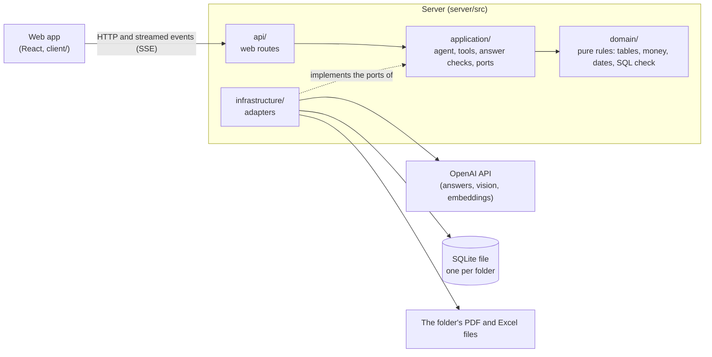

# Atlas

Atlas reads every PDF and Excel file in a folder and answers your questions about them, in English or Arabic. Each answer lists its sources: the file and page for a PDF, or the file, sheet and rows for a spreadsheet. Numbers in an answer are worked out by code (a database query or a calculator), not typed by the AI, so a total covers every row and can be checked. When the documents do not say, Atlas answers "not found" instead of guessing.


## Run it in six steps

You need an OpenAI API key. Everything else runs on your own computer.

1. **Install Node.js 24 and pnpm.**
   Download Node.js 24 from [nodejs.org](https://nodejs.org/en/download) (on macOS you can also run `brew install node@24`). Then switch on pnpm, the package manager this project uses; it comes with Node:
   ```sh
   corepack enable
   ```
2. **Get the code.**
   ```sh
   git clone https://github.com/MoSmeha/Atlas.git
   cd Atlas
   ```
3. **Install the libraries.**
   ```sh
   pnpm install
   ```
4. **Add your API key.** Copy the example settings file to `.env`, then open `.env` in a text editor and put your key after `OPENAI_API_KEY=`.

   | Windows (PowerShell) | macOS / Linux |
   | --- | --- |
   | `Copy-Item .env.example .env` | `cp .env.example .env` |

5. **Start Atlas.**
   ```sh
   pnpm dev
   ```
   This starts two programs: the server (port 3001) and the web app (port 5173). Leave the window open.
6. **Open [http://localhost:5173](http://localhost:5173).** The sample folder `samples/riyadh-tower` loads by itself. To use your own documents, type the full path of a folder in the sidebar (for example `C:\Projects\Tower` or `/Users/me/Projects/Tower`), or drop files onto it.

**Command line.** `pnpm cli <folder> "<question>"` asks one question without the browser, for example:

```sh
pnpm cli samples/riyadh-tower "Which BOQ items are above SAR 1M?"
```

## What it does

**What you can ask.** Plain questions about the loaded documents, for example:

- "Which cost items are above SAR 1 million?" (counted over every row, not a sample)
- "What is the scope of the main works contract?"
- "What are the key dates and deliverables?"
- "What changed between BOQ Rev 0 and Rev 1?"
- "Do the bills of quantities add up?"
- "ما الحجر الذي اعتُمد لواجهة المنصة؟" (asked in Arabic, answered in Arabic)

**What an answer contains.**

| Part | What you see |
| --- | --- |
| The answer | Text that appears word by word while Atlas works. You can stop it with the Stop button or Esc. |
| Result table | When the answer is a list or table, its rows appear under the answer, worked out by code. **Export** saves them as an Excel file (with a sources sheet) or a CSV file. |
| Sources | A numbered list: file and page for a PDF (with the quoted passage), or file, sheet and rows for a spreadsheet. Clicking a source opens it at that page or those rows. |
| How I found this | A folded list of every step Atlas took: what it searched for, the database query it ran, the pages it read, and how long each step took. |
| Warnings | Shown when Atlas could not fully check an answer, for example a number it could not trace to a document. |

**Around the chat.** The sidebar lists every file with its status (read, empty, damaged, password-protected, scanned, too large or skipped) and its document type (contract, BOQ, specification and so on). The top bar has a model picker, the cost and time of the last answer, and a button to clear the chat.

## Tools

Atlas works like a careful assistant with a set of tools. For each question, the AI decides which tools to use and in what order. Every tool is code: the AI asks, the code does the work.

| Tool | What it does |
| --- | --- |
| `list_documents` | Lists every file in the folder: its status, type, pages or sheets, language, currencies and the tables found in it. |
| `export_table` | Saves a result table as an Excel or CSV file the user can open. |
| `search_documents` | Finds the passages about a topic, by exact words and by meaning, and returns the file, page and a short extract. |
| `read_pages` | Returns the exact text of a range of PDF pages, so Atlas can quote and cite them. |
| `calculate` | Does arithmetic in code (totals, differences, percentages). It refuses numbers that did not come from a document or the question. |
| `extract_schedule` | Finds dates, deadlines, durations, milestones and deliverables in every document, with the sentence and page each comes from. |
| `query_tables` | Runs one read-only database query over every table Atlas loaded (BOQs, ledgers, schedules), for counts, totals and "above X" questions. |
| `check_boq_arithmetic` | Checks every bill of quantities: quantity times rate against the amount, and each total against the rows it adds up. |
| `look_at_page` | Shows one PDF page as an image to the AI and asks it a question. Used for scanned pages, drawings and stamps. |
| `compare_revisions` | Compares two revisions of a bill of quantities: items added, removed and changed, and the change in total per currency. |
| `submit_answer` | Hands in the final answer with its sources. Atlas checks it first: every number must trace to a tool result and every source must exist, or the answer goes back to the AI to fix. |

## Edge cases

What Atlas does with awkward files and questions, and the sample file in `samples/` that shows each one. One bad file never stops the others from loading.

| Case | What Atlas does | Sample |
| --- | --- | --- |
| Empty folder | Says the folder is empty and asks for a folder with PDF or Excel files. | `samples/empty-folder/` |
| Folder that does not exist | Says "Folder not found" with the path, and suggests copying it from the File Explorer address bar. | Type any wrong path |
| Damaged PDF | Lists it as **Corrupt** with the reason; it is not read. | `Drawing_Register.pdf` |
| Password-protected PDF | Lists it as **Encrypted**; Atlas is not given passwords. | `Tender_Addendum_03.pdf` |
| Excel file of 0 bytes | Lists it as **Empty**. | `Cost_Report_Empty.xlsx` |
| Workbook whose sheets are all empty | Lists it as **Empty**. | `Blank_Template.xlsx` |
| Scanned PDF (an image, no text) | Lists it as **Scanned**, then reads the page by showing the image to the AI (`look_at_page`). | `Site_Survey_Scanned.pdf` |
| 300-page PDF | Indexes every page once. Search finds the right pages; only those are read. | `Specification_Volume_2.pdf` |
| Sheet with 10,000 rows | Loads every row into a database table; counts and totals are a query over all rows. | `Cost_Ledger_10k.xlsx` |
| BOQ table running over several PDF pages | Reads it as one table. Repeated headers are skipped; "Carried forward" and "Brought forward" lines are marked as totals, not items. | `BOQ_Phase2_Facade.pdf` |
| Header row below title rows | Finds the real header under the title rows. | `BOQ_Phase1_Rev0.xlsx`, `Programme_Milestones.xlsx` |
| Merged header cells | Joins a two-row header, such as "Rates and Amounts (SAR)" over "Rate" and "Amount". | `BOQ_Phase1_Rev0.xlsx` |
| Two tables on one sheet | Splits them into separate tables, each with its own header and currency. | `Equipment_Imports.xlsx` |
| Amounts written as "SAR 1.2M" or in Arabic digits ("٣٢٠٬٠٠٠ ر.س") | Turns them into plain numbers (1,200,000 and 320,000) and keeps the currency. | `Provisional_Sums.xlsx` |
| Several currencies | Never adds them together: one total per currency. Each table keeps its own currency, and a query that adds them together is flagged back to the AI. | `Equipment_Imports.xlsx` |
| Arabic PDF, Arabic question | Reads the Arabic text in the right order and answers in Arabic, right to left. | `Meeting_Minutes_07_AR.pdf` |
| English question, answer only in the Arabic PDF | Search by meaning works across languages, so it finds the Arabic page; the answer is in English and cites the Arabic source. | `Meeting_Minutes_07_AR.pdf` |
| Two revisions of the same BOQ | Both load. `compare_revisions` lists what was added, removed and changed between them. | `BOQ_Phase1_Rev0.xlsx`, `BOQ_Phase1_Rev1.xlsx` |
| Word file (.docx) | Lists it as **Skipped**: only PDF and Excel files are read. | `Cover_Letter.docx` |
| Question the documents do not answer | Answers "not found", says what it looked for, and names any files it could not read. | Any question off the documents |
| Text in a document that gives the AI orders | Treated as document text, never as an instruction. Asked for the contract value, Atlas still gives SAR 187,462,350.00. | `Specification_Volume_2.pdf`, page 297 |

`samples/README.md` describes every sample file. `samples/expected.json` holds the right answers.

## How it is built

The server is split into layers. Arrows point from the part that uses to the part that is used.



- **domain**: rules with no outside connections, such as reading "SAR 1.2M" or finding a table header.
- **application**: the question-answering loop, the tools and the answer checks. It talks to the outside only through *ports* (interfaces).
- **infrastructure**: the *adapters* behind those ports: mupdf for PDFs, exceljs for Excel, SQLite for the index, OpenAI for the AI.
- **api**: the web routes the browser calls.

The index of a folder is one SQLite database file in `.atlas/indexes/`, so loading the same folder again is fast.

## Settings

Settings live in `.env` at the repository root (copied from `.env.example`). Only the API key is required.

| Name | In `.env.example` | If left out | What it means |
| --- | --- | --- | --- |
| `OPENAI_API_KEY` | (empty) | none | Your OpenAI key. Without it, Atlas lists files but cannot answer. |
| `ATLAS_FOLDER` | `samples/riyadh-tower` | no folder | Folder to load when the server starts. Relative paths start at the repository root. |
| `PORT` | `3001` | `3001` | Port of the server. The web app forwards its `/api` calls to it. |
| `ATLAS_DATA_DIR` | `.atlas` | `.atlas` | Where the index files and uploaded files are kept. |
| `ATLAS_LOG_DIR` | `.logs` | `.logs` | Where a log of each question is written (one JSON line per event). |
| `ATLAS_EXPORTS_DIR` | `exports` | `exports` | Where exported Excel and CSV files are saved. |
| `ATLAS_MAX_FILE_MB` | `200` | `200` | Files larger than this are listed as "too large" and not read. |
| `ATLAS_MAX_ROUNDS` | `12` | `12` | Most tool rounds per question before Atlas asks for the final answer. |

**Models.** `server/config/models.json` lists the OpenAI models Atlas may use, with their prices per million tokens, in three tiers: frontier, balanced and small. At start, Atlas asks OpenAI which models the key can see and picks, in each tier, the first listed model that is available (newest first). Questions go to the frontier model by default (`answerTier`); the model picker in the top bar switches to another tier. The small model sorts documents into types and checks schedule dates. Run `pnpm models` to see which models your key can see and the lineup Atlas will use.

## Project layout

```text
Atlas/
├── shared/      Data shapes shared by server and web app (Zod schemas)
├── server/
│   ├── src/
│   │   ├── domain/          Pure rules: tables, money, currencies, dates, SQL safety
│   │   ├── application/     Agent loop, tools, answer checks, ports
│   │   ├── infrastructure/  Adapters: PDF, Excel, SQLite, OpenAI, files, logs
│   │   └── api/             Web routes
│   ├── config/      models.json: model IDs and prices
│   ├── scripts/     Sample generator, model check, eval
│   └── test/        Tests, laid out like src/, with fakes in test/fakes
├── client/      Web app (React, Vite, Mantine)
├── samples/     Fictional sample documents and their right answers
└── docs/        Screenshot, time log and eval report
```

## Tests and eval

| Command | What it does |
| --- | --- |
| `pnpm test` | Runs the unit tests. Needs no API key and no network. |
| `pnpm typecheck` | Checks the TypeScript types in all three packages. |
| `pnpm eval` | Asks the real AI a set of questions about the sample folder and compares the answers with `samples/expected.json`. **Costs money** (it uses your API key). Writes the results to `docs/EVAL.md`. |
| `pnpm samples` | Makes the sample documents again. Needs Microsoft Edge, which renders the Arabic minutes. |

**Latest eval:** 20 of 21 questions passed on GPT-6 Astra, with a median answer time of 9.6 seconds and $1.48 for the whole run. The one miss and every answer's time and cost are in [docs/EVAL.md](docs/EVAL.md).

## How to add a tool

1. **Shared shape (only if the web app shows the result).** Add a Zod schema to `shared/src/schemas/`.
2. **The tool.** Add one file to `server/src/application/tools/`, built with `defineTool`. Parameters are a Zod object; optional fields use `.nullable()`. Use only the ports in the context (`context.index`, `context.model` and so on), never SQLite, mupdf or OpenAI directly. Throw `ToolError` for a problem the AI can fix.
3. **Register it.** Add it to the `tools` list in `server/src/application/tools/registry.ts`. The instructions test checks that every tool is named in the agent instructions, so add one advice line for it to `STRATEGY` in `server/src/application/agent/instructions.ts`.
4. **A unit test.** Add a test in `server/test/application/tools/` using the fakes in `server/test/fakes/` (`FakeIndex`, `makeToolContext`).
5. **An eval question.** Add one question that needs the tool to `server/scripts/eval/questions.ts`.

A tiny example, a tool that gives a PDF's page count:

```ts
// server/src/application/tools/pageCount.ts
import { z } from 'zod';
import { defineTool, ToolError } from './Tool';

export const pageCount = defineTool({
  name: 'page_count',
  description: 'Returns how many pages one PDF has. Give the file name from list_documents.',
  parameters: z.object({ document: z.string().describe('File name or path from list_documents.') }),
  async run(args, context) {
    const doc = context.index.find(args.document);
    if (doc === null || doc.pageCount === null) throw new ToolError(`No PDF named "${args.document}".`);
    return { output: { document: doc.path, pages: doc.pageCount }, summary: `${doc.name} has ${doc.pageCount} pages` };
  },
});
```

```ts
// server/test/application/tools/pageCount.test.ts
import { expect, it } from 'vitest';
import { pageCount } from '../../../src/application/tools/pageCount';
import { FakeIndex } from '../../fakes/FakeIndex';
import { pdfRecord } from '../../fakes/records';
import { makeToolContext } from '../../fakes/toolContext';

it('counts the pages of a PDF', async () => {
  const index = new FakeIndex();
  index.save(pdfRecord('Contract.pdf', ['Scope', 'Payment']));
  const result = await pageCount.run({ document: 'Contract.pdf' }, makeToolContext({ index }));
  expect(result.output).toEqual({ document: 'Contract.pdf', pages: 2 });
});
```

## Licences

Atlas reads PDFs with mupdf, which is AGPL-3.0, so this repository carries no permissive LICENSE file. The other main libraries are MIT (React, Mantine, Fastify, exceljs, better-sqlite3, Zod, chokidar, Vite) or Apache-2.0 (the OpenAI SDK, pdf.js).

## Assumptions and defaults

- **Models.** Answers use OpenAI's frontier model by default (GPT-6 Astra on the key used here), because answer quality matters more than cost for a demo. The rule was to switch the default to the balanced model (GPT-6.1 Sol) if the median answer took longer than 20 seconds; the eval measured 9.6 seconds, so Astra stays. The picker offers all three. A small, cheap model (GPT-6 Luna) does bulk work such as sorting documents into types. Search by meaning uses `text-embedding-3-small`. The model IDs and prices live in `server/config/models.json`; at start Atlas keeps only the models your key can see.
- **Local only.** Atlas, its index and your files stay on your computer. The AI runs at OpenAI, so document text is sent there: passages for search by meaning, the start of each file to sort it into a type, the pages a question needs, and page images for scanned pages.
- **One folder at a time.** Loading a new folder replaces the current one.
- **PDF and Excel only** (`.pdf`, `.xlsx`, `.xlsm`). Old `.xls`, CSV, Word and images are listed as skipped, with the reason.
- **No passwords.** Password-protected files are listed, not opened.
- **Currencies are never converted.** Amounts in different currencies are totalled separately.
- **The interface is in English.** Questions and answers can be in English or Arabic.
- **Fictional samples.** Every sample document was invented for testing; no real company document was used.
