# Atlas

**Ask your project documents a question. Get an answer you can check.**

Atlas reads a folder of PDFs and Excel files (contracts, bills of quantities, specifications, meeting minutes) and answers questions about them in English or Arabic. Every answer shows where it came from, down to the page or the spreadsheet row.

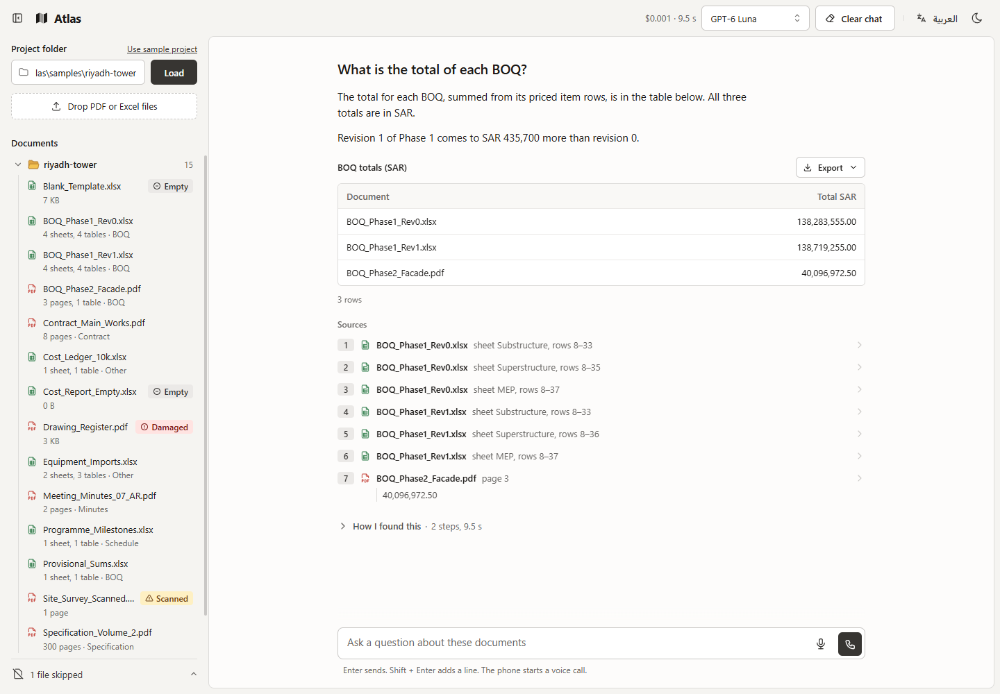

## Contents

1. [What Atlas does](#what-atlas-does)
2. [See it in action](#see-it-in-action)
3. [Talk to Atlas](#talk-to-atlas)
4. [Pick the AI model](#pick-the-ai-model)
5. [English or Arabic, light or dark](#english-or-arabic-light-or-dark)
6. [How it works](#how-it-works)
7. [Tech stack](#tech-stack)
8. [Run it yourself](#run-it-yourself)
9. [Good to know](#good-to-know)

## What Atlas does

- **Reads your files.** Point it at a folder. It reads every PDF and spreadsheet, including scanned pages and 300-page specifications.
- **Answers in plain words.** Ask the way you would ask a colleague: "Which items cost more than a million riyals?"
- **Shows its sources.** Every fact links to the page or rows it came from. One click opens it, highlighted.
- **Never makes up numbers.** Totals and lists are worked out by code over every row. The AI does not type them.
- **Says when it does not know.** If the answer is not in your files, Atlas says so and names the files it could not open.

## See it in action

**1. Load a folder.** Atlas lists every file, flags the ones it cannot read (damaged, password protected, empty, scanned), and suggests questions to start with.

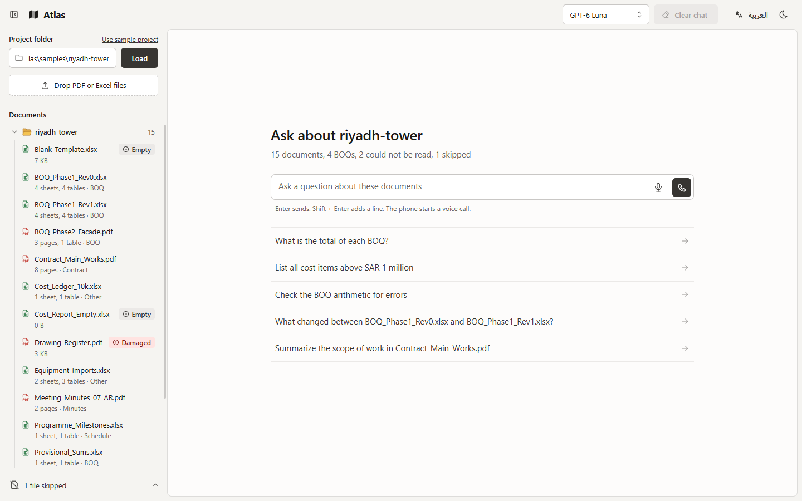

**2. Get exact lists.** "Above SAR 1 million" checks every row, not a sample. Download the list as Excel or CSV.

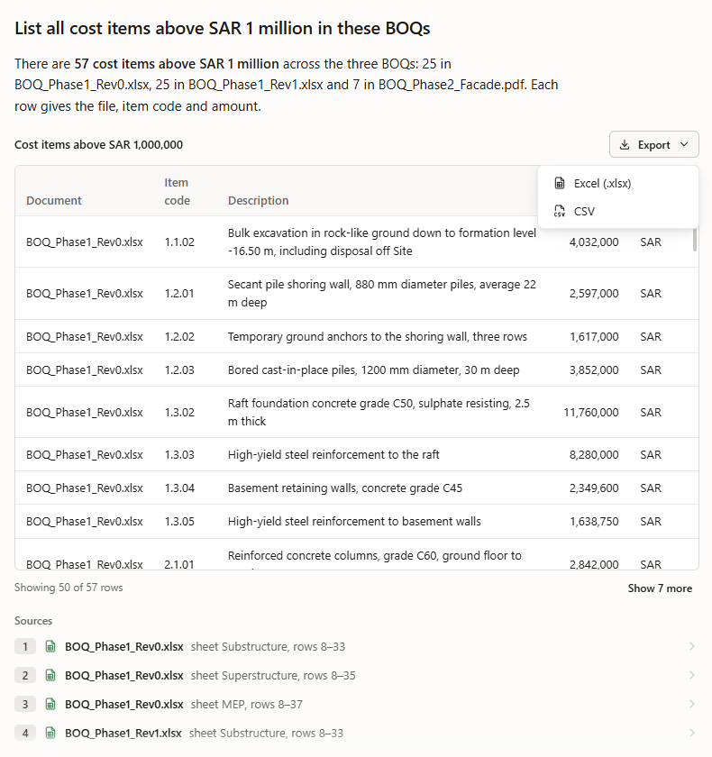

**3. Check the page.** Click a source and the PDF opens at the right page, with the sentence highlighted.

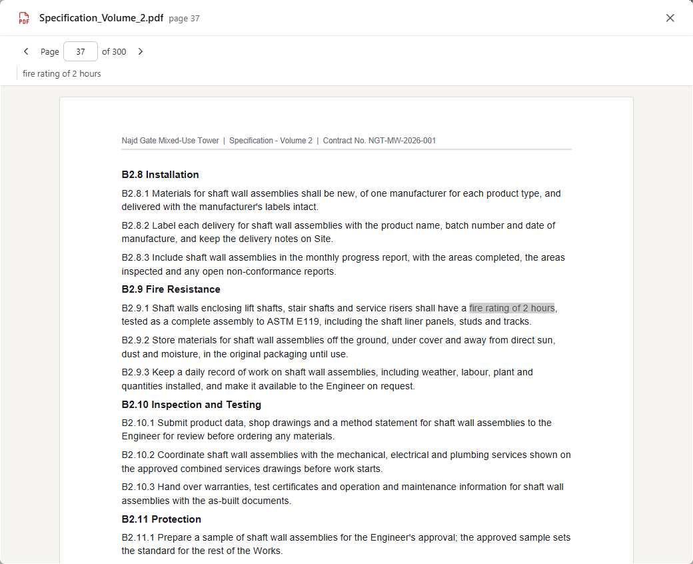

**4. Or the rows.** A spreadsheet opens with the rows the answer used marked.

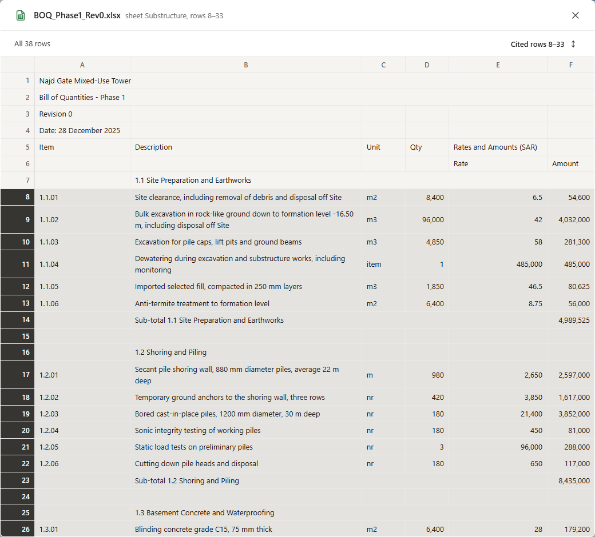

**5. Compare versions.** What was added, removed and changed between two revisions, and how the total moved.

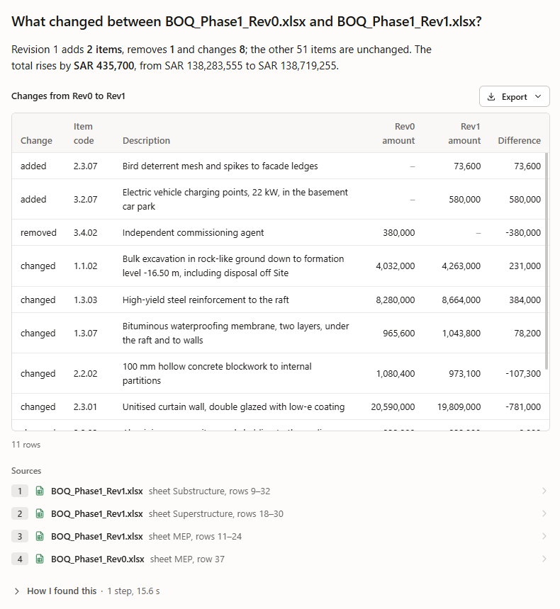

**6. No guessing.** When the files do not say, Atlas says so, names the files it could not open, and shows every place it looked.

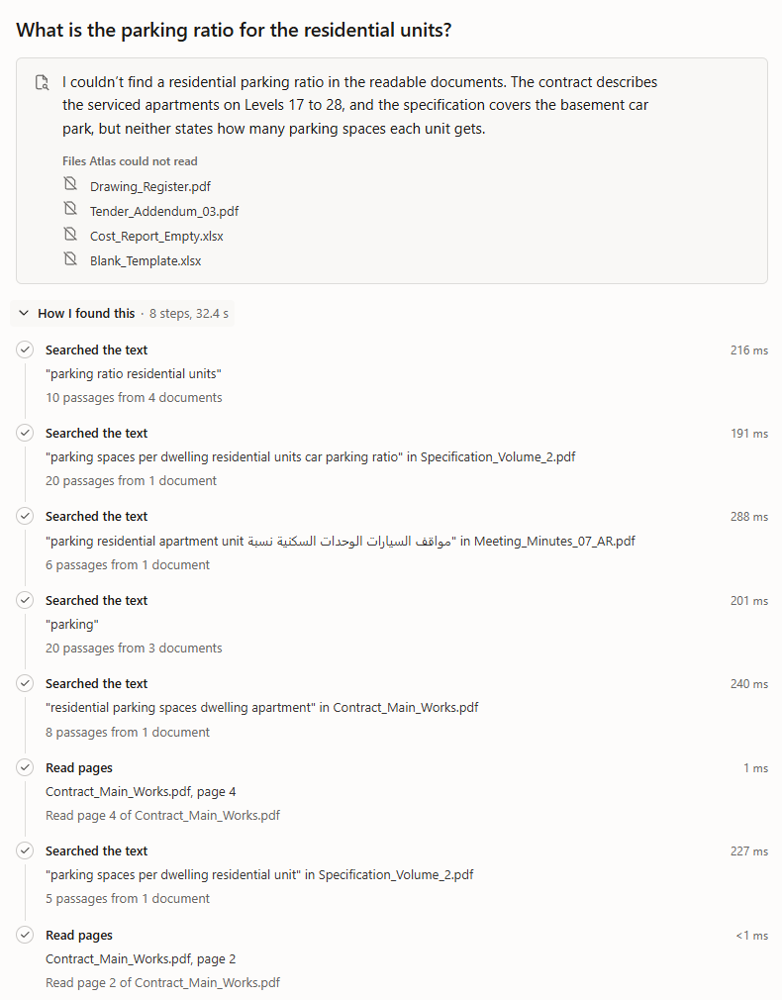

## Talk to Atlas

Press the phone button and talk to Atlas as you would on a call, in English or in your own Arabic dialect. Atlas answers out loud, and the same answer appears on screen with its table and sources.

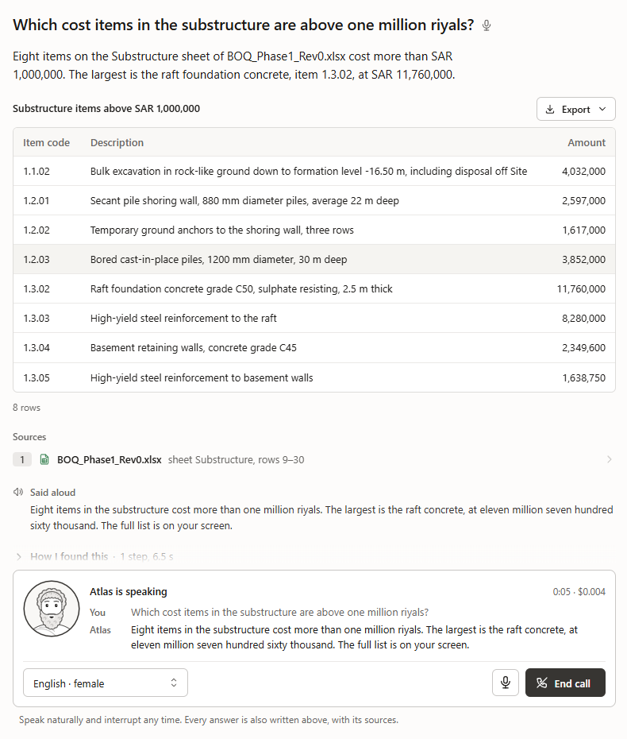

<table>
  <tr>
    <td width="270">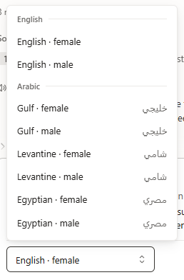</td>
    <td>

- **English and five Arabic dialects:** Gulf, Levantine, Egyptian, North African and Modern Standard, each with a female and a male voice.
- **Pick the voice before you call,** from the arrow beside the call button. Interrupt any time, or mute yourself.
- **The same checked answers.** The voice reads out the answer Atlas has already checked. It never works out numbers by itself.
- **A face.** A line-drawn bust blinks, listens and moves its mouth as it speaks.
- **Prefer typing?** The microphone button turns your speech into a typed question you can read before sending.

</td>
  </tr>
</table>

## Pick the AI model

Choose which AI answers from the top bar: a cheap, fast one for everyday questions or a stronger one for hard ones. Atlas shows what each answer cost and how long it took.

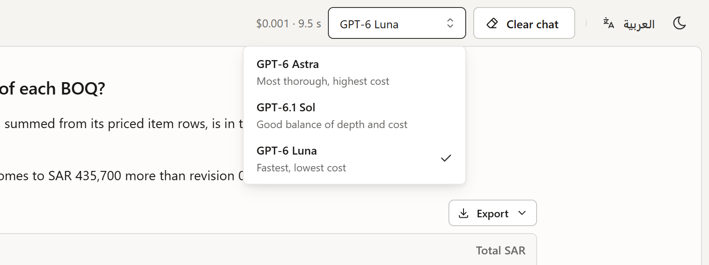

| Model | Best for | Cost |
| --- | --- | --- |
| GPT-6 Luna | Everyday questions (the default) | Lowest |
| GPT-6.1 Sol | A balance of depth and cost | Medium |
| GPT-6 Astra | The hardest questions | Highest |

On the sample project, Luna answered all 21 test questions correctly for 2 cents in total ([test report](docs/EVAL.md)).

## English or Arabic, light or dark

The whole app switches between English and Arabic (right to left) and between light and dark, from the top bar. Ask in Arabic and Atlas answers in Arabic. File names and numbers stay exactly as written.

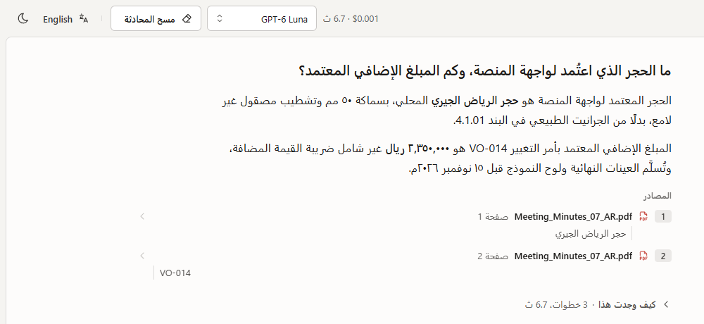

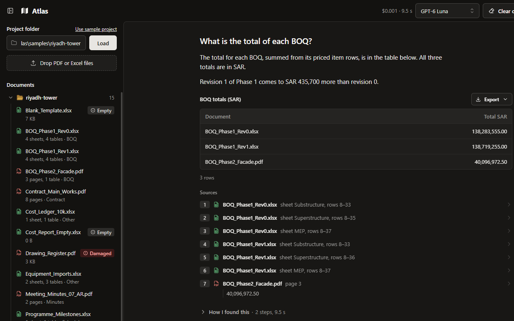

## How it works

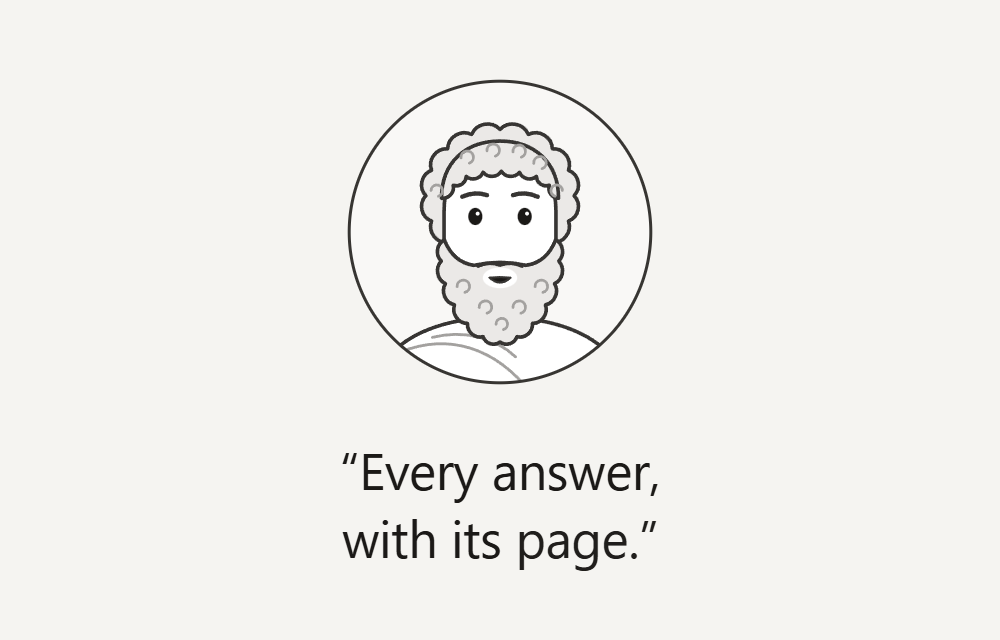

The AI never has to invent a number. It plans what to look up, and code does the work: it searches the text, reads pages and adds up table rows. Before you see anything, Atlas checks that every number came from that work and every source really exists. If something is off, the AI has to fix it.

A voice call takes the same road. The voice only listens and speaks; your question goes through the same steps and checks as a typed one.

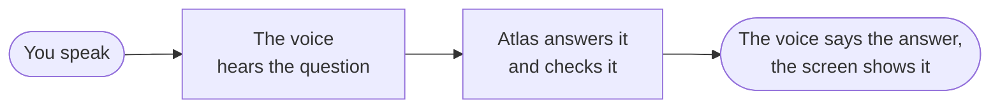

## Tech stack

| Part | Built with |
| --- | --- |
| Web app | React, Vite, Mantine, TypeScript |
| Server | Node.js 24, Fastify, TypeScript |
| AI | OpenAI: GPT-6 models for answers, GPT-Live for voice calls, gpt-transcribe for dictation, text-embedding-3-small for search by meaning |
| Reading files | mupdf for PDFs, exceljs for Excel |
| Storage | SQLite on your computer, one file per folder, with keyword search |
| Data shapes | Zod, shared by the server and the web app |
| Tests | Vitest: about 1,760 tests that need no key and no network |

## Run it yourself

| Step | Windows (PowerShell) | macOS / Linux |
| --- | --- | --- |
| 1. Install Node.js 24 | [nodejs.org](https://nodejs.org/en/download) | [nodejs.org](https://nodejs.org/en/download) or `brew install node@24` |
| 2. Switch on pnpm | `corepack enable` | `corepack enable` |
| 3. Get the code | `git clone https://github.com/MoSmeha/Atlas.git; cd Atlas` | `git clone https://github.com/MoSmeha/Atlas.git && cd Atlas` |
| 4. Install | `pnpm install` | `pnpm install` |
| 5. Add your OpenAI key | `Copy-Item .env.example .env`, then set `OPENAI_API_KEY=` | `cp .env.example .env`, then set `OPENAI_API_KEY=` |
| 6. Start | `pnpm dev`, then open http://localhost:5173 | `pnpm dev`, then open http://localhost:5173 |

A sample project, a fictional tower in Riyadh, loads by itself. To use your own files, type a folder path in the sidebar or drop files on it.

## Good to know

- **Your files stay on your computer.** The app and its index run locally. The AI runs at OpenAI, so the passages and page images it needs are sent there.
- **Cost.** A question on Luna costs a fraction of a cent. A voice call costs $0.05 a minute.
- **File types.** PDF and Excel (`.pdf`, `.xlsx`, `.xlsm`). Other files are listed and skipped.
- **Sample documents are fictional.** `samples/expected.json` holds their right answers.
- **Licence.** mupdf is AGPL-3.0, so this repository has no permissive licence file.
- **For developers.** Settings, the eleven tools, edge cases, project layout, tests and how to add a tool are in [docs/TECHNICAL.md](docs/TECHNICAL.md). Design notes are in [docs/NOTE.md](docs/NOTE.md), time spent in [docs/TIMELOG.md](docs/TIMELOG.md), and the design system in [client/DESIGN.md](client/DESIGN.md).
