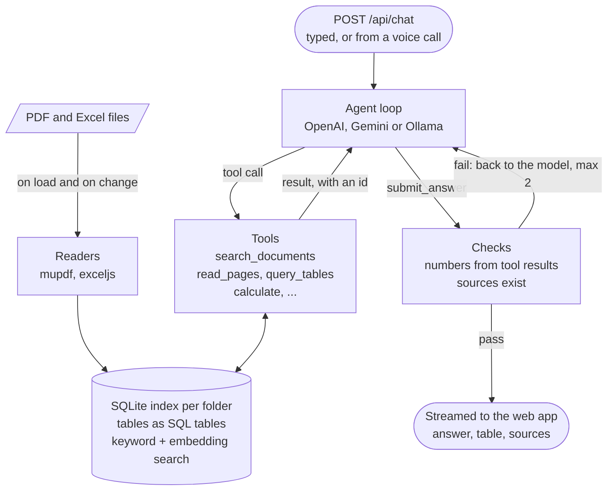

# Atlas

**Ask your project documents a question. Get an answer you can check.**

Atlas reads a folder of PDFs and Excel files (contracts, bills of quantities, specifications, meeting minutes) and answers questions about them in English or Arabic. Every answer shows where it came from, down to the page or the spreadsheet row.


## Contents

1. [What Atlas does](#what-atlas-does)
2. [See it in action](#see-it-in-action)
3. [Talk to Atlas](#talk-to-atlas)
4. [Pick the AI model](#pick-the-ai-model)
5. [English or Arabic, light or dark](#english-or-arabic-light-or-dark)
6. [How it works](#how-it-works)
7. [Tech stack](#tech-stack)
8. [Run it yourself](#run-it-yourself)
9. [Good to know](#good-to-know)

## What Atlas does

- **Reads a whole folder,** every PDF and spreadsheet, scanned pages included, and answers questions asked in plain words.
- **Shows its sources.** Every fact links to its page or rows; one click opens it, highlighted.
- **Never makes up numbers.** Code works out totals over every row, and when the files do not say, Atlas says so.

## See it in action

**1. Load a folder.** Atlas lists every file and flags the ones it cannot read (damaged, password protected, empty, scanned). Then type your question in the box at the foot.


**2. Get exact lists.** Ask "which items are above SAR 1 million?" and Atlas checks every row of every file, PDF tables included, not a sample. Download just those items as Excel, with their sources, or as CSV.


**3. Check the page.** Click a source and the PDF opens at the right page, with the sentence highlighted.


**4. Or the rows.** A spreadsheet opens with the rows the answer used marked.


**5. Compare two editions of a BOQ.** Ask what changed between Rev0 and Rev1 of a bill of quantities, and Atlas lists the items added, removed and changed, and how the total moved.


**6. No guessing.** When the files do not say, Atlas says so, names the files it could not open, and shows every place it looked.


## Talk to Atlas

Press the phone button and talk to Atlas as you would on a call, in English or in your own Arabic dialect.


<table>
  <tr>
    <td width="270"></td>
    <td>

- **English and five Arabic dialects** (Gulf, Levantine, Egyptian, North African, Modern Standard), female or male.
- **Pick the voice** from the arrow beside the call button.
- **Checked answers.** The voice reads out the checked answer and never works out numbers itself.
- **Prefer typing?** The microphone button turns speech into a question you can edit before sending.

</td>
  </tr>
</table>

## Pick the AI model

Pick the model, and how long it thinks, from the top bar. Each answer shows what it cost and how long it took.


| Model | Best for | Cost |
| --- | --- | --- |
| GPT-6 Luna | Everyday questions | Lowest |
| GPT-6.1 Sol | A balance of depth and cost | Medium |
| GPT-6 Astra | The hardest questions | Highest |

### Or use it for free

| Free option | How to set it up | Good to know |
| --- | --- | --- |
| Gemini's free tier | Get a key at [aistudio.google.com/apikey](https://aistudio.google.com/apikey) and add `GEMINI_API_KEY=` to `.env` | Daily limit. Google may use what it is sent, so keep confidential files off it |
| A model on your computer | Install [Ollama](https://ollama.com), then run `ollama pull qwen3:14b` and `ollama pull bge-m3` | Nothing leaves your computer. Needs a graphics card with 6 GB or more, or a Mac with Apple silicon and 16 GB or more |

Free models sit in the same picker. Voice calls still use OpenAI.

## English or Arabic, light or dark

Switch between English and Arabic, and light and dark, from the top bar. Atlas answers in the language you ask in.


## How it works

<p align="center"></p>

An AI model and ordinary code share the work. The model reads your question and decides what to look up. Code does the looking up: it searches the files, reads pages and adds up table rows. The model then writes the answer from what the code found. Before you see it, Atlas checks that every number in the answer appears in those results and that every source points to a real page or row. An answer that fails goes back to the model to fix.


A voice call takes the same path: the voice only listens and speaks, and the question it hears is answered and checked like a typed one.

### In the code



Each step has its own chart in [docs/TECHNICAL.md](docs/TECHNICAL.md).

## Tech stack

| Part | Built with |
| --- | --- |
| Web app | React, Vite, Mantine, TypeScript |
| Server | Node.js 24, Fastify, TypeScript |
| AI | OpenAI: GPT-6 models for answers, GPT-Live for voice calls, gpt-transcribe for dictation, text-embedding-3-small for search by meaning. Free instead: Gemini (Google's free tier) or a local model through Ollama |
| Reading files | mupdf for PDFs, exceljs for Excel |
| Storage | SQLite on your computer, one file per folder, with keyword search |
| Data shapes | Zod, shared by the server and the web app |
| Tests | Vitest: about 1,890 tests that need no key and no network |

## Run it yourself

| Step | Windows (PowerShell) | macOS / Linux |
| --- | --- | --- |
| 1. Install Node.js 24 | [nodejs.org](https://nodejs.org/en/download) | [nodejs.org](https://nodejs.org/en/download), or Homebrew (see [On a Mac](#on-a-mac)) |
| 2. Switch on pnpm | `corepack enable` | `corepack enable` |
| 3. Get the code | `git clone https://github.com/MoSmeha/Atlas.git; cd Atlas` | `git clone https://github.com/MoSmeha/Atlas.git && cd Atlas` |
| 4. Install | `pnpm install` | `pnpm install` |
| 5. Add a model key | `Copy-Item .env.example .env`, then set `OPENAI_API_KEY=`, or `GEMINI_API_KEY=` to use it free | `cp .env.example .env`, then set `OPENAI_API_KEY=`, or `GEMINI_API_KEY=` to use it free |
| 6. Start | `pnpm dev`, then open http://localhost:5173 | `pnpm dev`, then open http://localhost:5173 |

A sample project, a fictional tower in Riyadh, loads by itself. To use your own files, click the folder button in the sidebar and choose a folder, type its path, or drop files on the sidebar.

### On a Mac

The same steps, with what a Mac asks along the way. Open Terminal (Applications, then Utilities), and press Return after each command.

1. **Install Node.js 24.** The simplest way is the macOS installer at [nodejs.org](https://nodejs.org/en/download): pick version 24. With [Homebrew](https://brew.sh) instead, run these three lines. Homebrew keeps `node@24` off the path, and the second line puts it there:

   ```sh
   brew install node@24
   echo "export PATH=\"$(brew --prefix node@24)/bin:\$PATH\"" >> ~/.zshrc
   source ~/.zshrc
   ```

   `node --version` should now print a version starting with `v24`.
2. **Switch on pnpm:** `corepack enable`. If it says permission denied, run `sudo corepack enable` and type your Mac password. If it says command not found, run `npm install -g pnpm` instead.
3. **Get the code:** `git clone https://github.com/MoSmeha/Atlas.git && cd Atlas`. On a Mac without developer tools, this asks to install the "command line developer tools": click Install, wait for it to finish, then run the line again.
4. **Install:** `pnpm install`. If it asks to download pnpm, type `Y`.
5. **Add a model key:** `cp .env.example .env`, then `open -e .env` opens the file in TextEdit. Paste your key after `GEMINI_API_KEY=` (free) or `OPENAI_API_KEY=`, and save.
6. **Start:** `pnpm dev`, then open http://localhost:5173 in Safari, Chrome or Edge. Press Control+C in Terminal to stop.

The first voice call or dictation asks for the microphone. Allow it in the browser, and in System Settings, Privacy & Security, Microphone if macOS asks too.

To answer for free on the Mac itself, Ollama runs on Apple silicon. `qwen3:14b` needs 24 GB of memory; with 16 GB, run `ollama pull qwen3:8b` in its place.

## Good to know

- **Your files stay on your computer.** The app and its index run locally. The AI runs at OpenAI or Google (Gemini), so the passages and page images it needs are sent there; with Ollama nothing leaves the computer.
- **Cost.** A question on Luna costs a fraction of a cent, and nothing on Gemini's free tier or Ollama. A voice call costs $0.05 a minute.
- **File types.** PDF and Excel (`.pdf`, `.xlsx`, `.xlsm`). Other files are listed and skipped.
- **Sample documents are fictional.** `samples/expected.json` holds their right answers.
- **Licence.** mupdf is AGPL-3.0, so this repository has no permissive licence file.
- **For developers.** Settings, the eleven tools, edge cases, project layout, tests and how to add a tool are in [docs/TECHNICAL.md](docs/TECHNICAL.md). Design notes are in [docs/NOTE.md](docs/NOTE.md), time spent in [docs/TIMELOG.md](docs/TIMELOG.md), and the design system in [client/DESIGN.md](client/DESIGN.md).
