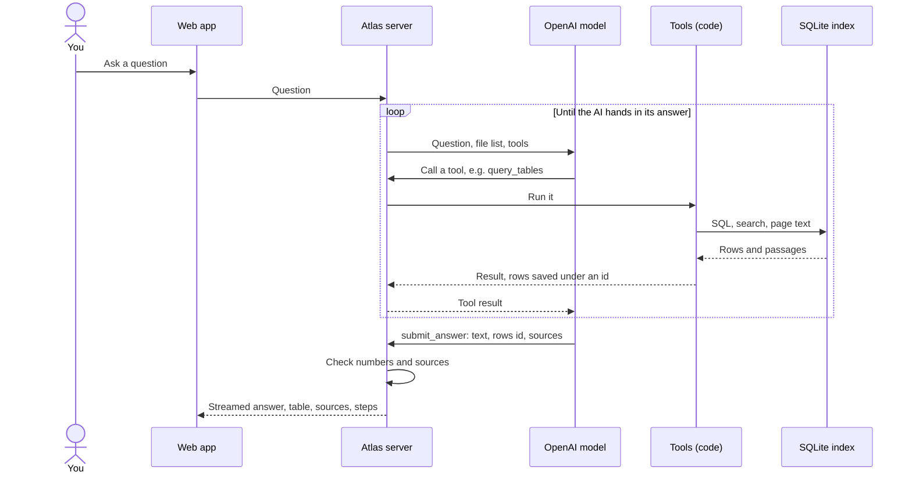
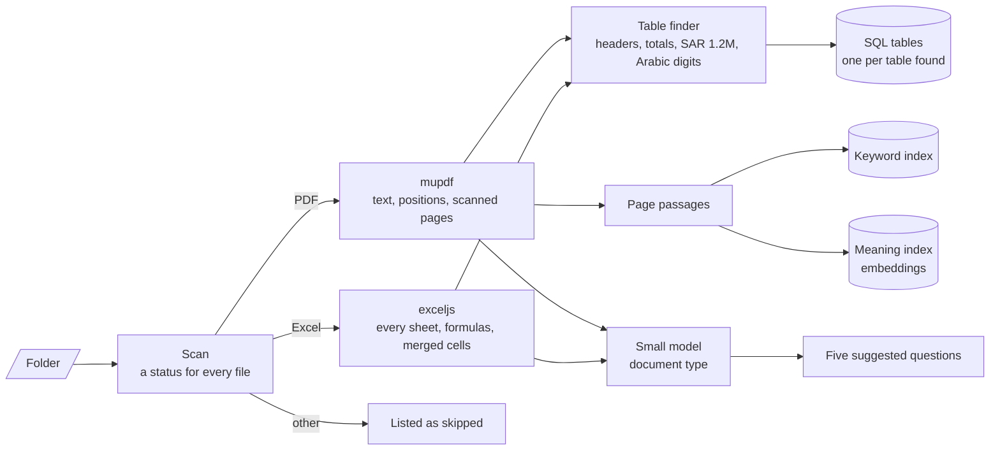
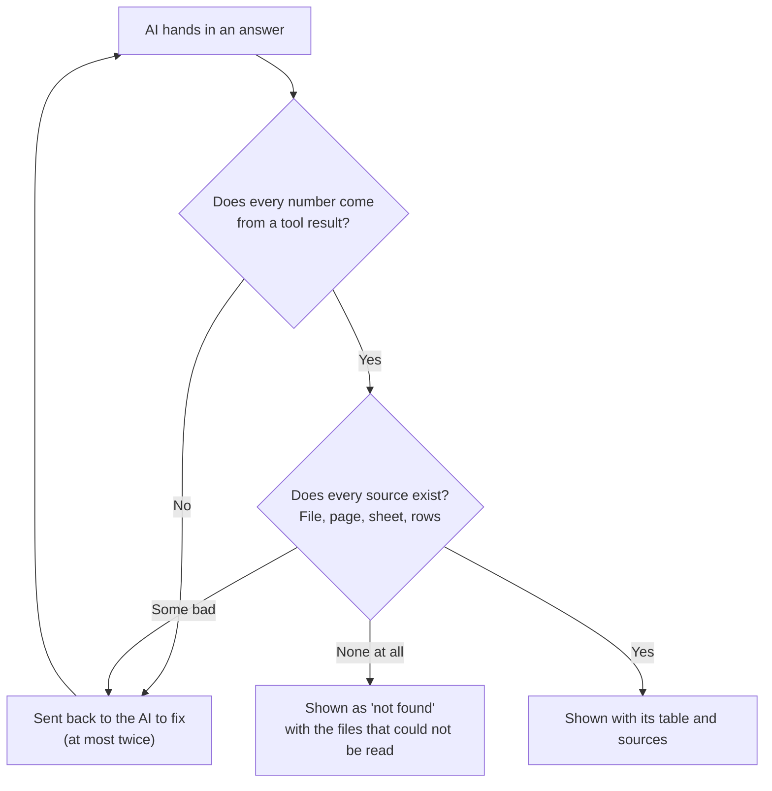
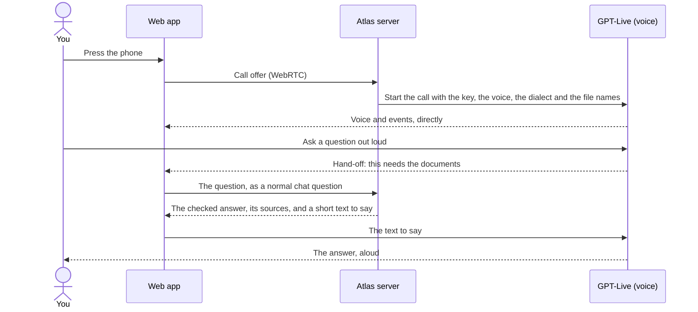
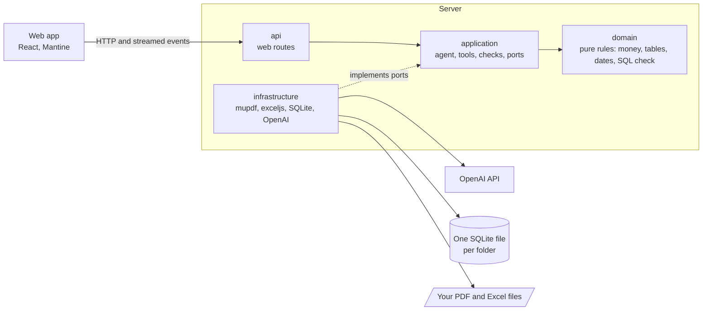
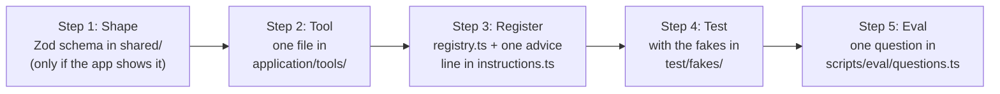

# Atlas: technical guide

The [README](../README.md) shows what Atlas does. This page covers how it works inside, how to set it up, and how to extend it.

## Contents

1. [How a question becomes an answer](#how-a-question-becomes-an-answer)
2. [What happens when a folder loads](#what-happens-when-a-folder-loads)
3. [Every answer is checked](#every-answer-is-checked)
4. [Voice calls](#voice-calls)
5. [How the code is arranged](#how-the-code-is-arranged)
6. [Tools](#tools)
7. [Edge cases](#edge-cases)
8. [Settings](#settings)
9. [Project layout](#project-layout)
10. [Tests and eval](#tests-and-eval)
11. [Add a tool](#add-a-tool)

## How a question becomes an answer



## What happens when a folder loads



A watcher re-reads a file as soon as it is added or changed. The index is cached per folder, so loading a folder again takes milliseconds.

Each row of the sidebar's tree has a × that removes it from Atlas, and its pages, tables and passages from the index, at once (`IndexFolder.remove`):

- **In the uploads folder** (`<ATLAS_DATA_DIR>/uploads`) the uploaded copy is deleted, after a question, since that cannot be undone.
- **In a folder loaded by its path** the file stays on disk. Its path goes on the index's `excluded` list, which every scan and watcher update skips, and the sidebar's foot lists it with Put back (`POST /api/folder/restore`), which scans the folder again.
- **The top folder's ×** unloads the folder (`DELETE /api/folder`): indexing and watching stop and its index file is deleted. Uploaded files are deleted too; a folder loaded by its path keeps its files.

## Every answer is checked



## Voice calls



- **The voice never answers about the documents itself.** GPT-Live (`gpt-live-1`) listens, takes turns and speaks; every question about the documents goes to the same agent and checks as a typed one, so totals still come from SQL. The voice gets a short text built from the checked answer (its first sentences, the table's first rows and the sources, with every number exactly as computed) and is told to say numbers as given. What it actually said is kept under the answer as "Said aloud", so the two can be compared.
- **Arabic voices are designed.** GPT-Live has no Arabic voices built in, so Atlas designs one per dialect and gender from a description and a sample script in that dialect. The server makes any missing voice once, in the background when it starts, so calls do not wait; a call that needs a voice before then makes it while it connects, which takes about 20 seconds (creating a voice is free; its id is kept in `.atlas/voices.json`). Each dialect's speaking rules are written in the dialect itself. How close each voice sounds to its dialect is up to the voice model: listen, then tune the descriptions in `server/config/voices.json`.
- **Cost.** A call costs $0.05 a minute, billed by the second, plus the usual cost of each answer. It hangs up after 2 minutes with nothing said and at 30 minutes, and closing the page or stopping the server hangs it up too. The call's cost is added to the chat's total. Dictation uses `gpt-transcribe` at $0.0045 a minute, with the folder's file and sheet names as hints.
- **Your key stays on the server.** The browser sends its call offer to the Atlas server, which starts the call with the key; only audio and events go between the browser and OpenAI.

The voice is chosen before the call, from the arrow beside the call button, and is fixed once the call starts. A browser set to Arabic starts calls in Gulf Arabic; any other starts in English. The last choice is remembered.

**Starting quickly.** Atlas greets with one short line ("I'm Atlas. Ask me anything.", or the dialect's own in `voices.json`), asked for word for word at about one and a half times the usual pace; the Live guide sets pace in words, and the voice has no speed setting. The browser's first WebRTC offer on a page costs about 0.8 s in Edge, so the client makes a throwaway one ahead of time (`warmUpCalls`) and the call's own offer takes milliseconds. Each `call_end` log entry's `diagnosis.startup` gives the milliseconds from pressing Call to the microphone, the offer, the server's answer, `session.started` and Atlas's first words, so a slow start shows which step held it up.

## How the code is arranged



## Tools

The AI decides which tools to call. The tools are code: the AI asks, and the code does the work.

| Tool | Job |
| --- | --- |
| `list_documents` | Every file: its status, type, pages or sheets, tables and currencies |
| `search_documents` | Finds passages by exact words and by meaning |
| `read_pages` | Exact text of a range of PDF pages |
| `query_tables` | One read-only SQL query over every loaded table |
| `look_at_page` | Shows a page image to the AI, for scanned pages and drawings |
| `check_boq_arithmetic` | Quantity × rate against the amount, and subtotals against their rows |
| `extract_schedule` | Dates, deadlines, durations and deliverables, Hijri dates included |
| `compare_revisions` | Two BOQ revisions: items added, removed and changed |
| `calculate` | Safe arithmetic on numbers the tools returned |
| `export_table` | Saves a result as `.xlsx` or `.csv` |
| `submit_answer` | Hands in the answer, which is then checked as shown above |

## Edge cases

| Case | What Atlas does | Sample |
| --- | --- | --- |
| Damaged PDF | Listed as **Damaged** | `Drawing_Register.pdf` |
| Password-protected PDF | Listed as **Password protected** | `Tender_Addendum_03.pdf` |
| 0-byte Excel file | Listed as **Empty** | `Cost_Report_Empty.xlsx` |
| Workbook with only empty sheets | Listed as **Empty** | `Blank_Template.xlsx` |
| Scanned PDF | Listed as **Scanned**, read as an image | `Site_Survey_Scanned.pdf` |
| Word file | Listed as **skipped** | `Cover_Letter.docx` |
| 300-page PDF | Search finds the right pages; only those are read | `Specification_Volume_2.pdf` |
| 10,000-row sheet | All rows in SQL; counts and totals cover every row | `Cost_Ledger_10k.xlsx` |
| BOQ running over PDF pages | One table; carried-forward lines are not items | `BOQ_Phase2_Facade.pdf` |
| Header under title rows, merged headers | Real header found, headers joined | `BOQ_Phase1_Rev0.xlsx` |
| Two tables on one sheet | Split, each with its own currency | `Equipment_Imports.xlsx` |
| "SAR 1.2M", Arabic-Indic digits | Read as plain numbers | `Provisional_Sums.xlsx` |
| Several currencies | Never added together; one total per currency | `Equipment_Imports.xlsx` |
| Arabic PDF | Read in the right order; Arabic questions answered in Arabic | `Meeting_Minutes_07_AR.pdf` |
| English question, answer only in Arabic | Found by meaning, answered in English | `Meeting_Minutes_07_AR.pdf` |
| Two revisions of a BOQ | Compared row by row | `BOQ_Phase1_Rev0/Rev1.xlsx` |
| Question not in the documents | "Not found", with the unreadable files named | Any off-topic question |
| A document that orders the AI around | Treated as text; the real contract value is given | `Specification_Volume_2.pdf` p. 297 |
| Empty folder, wrong path | A clear message in the sidebar | `samples/empty-folder/` |

Every sample document is fictional. `samples/README.md` describes each file, and `samples/expected.json` holds the right answers.

## Settings

Settings live in `.env`. Only a model is required: one key, or Ollama.

| Name | Default | What it means |
| --- | --- | --- |
| `OPENAI_API_KEY` | none | Your OpenAI key. Voice calls and dictation need it, whichever provider answers |
| `GEMINI_API_KEY` | none | A Gemini key, for the free tier ([aistudio.google.com/apikey](https://aistudio.google.com/apikey)) |
| `ATLAS_PROVIDER` | `auto` | `auto`, `openai`, `gemini` or `ollama`. A named provider is used only if it can be; `ollama` also allows a machine without a big enough graphics card, which is slow |
| `OLLAMA_HOST` | `127.0.0.1:11434` | Where Ollama listens |
| `ATLAS_FOLDER` | `samples/riyadh-tower` | Folder loaded at start |
| `PORT` | `3001` | Server port; the web app forwards to it |
| `ATLAS_DATA_DIR` | `.atlas` | Index cache and uploads |
| `ATLAS_LOG_DIR` | `.logs` | One log line per tool call and question |
| `ATLAS_EXPORTS_DIR` | `exports` | Exported `.xlsx` and `.csv` files |
| `ATLAS_MAX_FILE_MB` | `200` | Larger files are listed as too large |
| `ATLAS_MAX_ROUNDS` | `12` | Tool rounds before the AI must answer |

**Models** are set in `server/config/models.json`.

| Tier | Model | Used for |
| --- | --- | --- |
| small | GPT-6 Luna | **Default for answers** (cheap), sorting documents into types, confirming dates |
| balanced | GPT-6.1 Sol | Picker option |
| frontier | GPT-6 Astra | Picker option for the hardest questions |

Atlas keeps only the models your key can see; `pnpm models` lists them. Change `answerTier` to change the default.

**Free providers.** With `ATLAS_PROVIDER=auto` Atlas answers with the first that works: a local model through Ollama, then Gemini's free tier, then OpenAI. The server's first lines say which one answers and why, and the top bar shows a "Free tier" badge (or "Free, on this computer") beside the model picker while a free one does; its tooltip says what that means.

- **Gemini** has its own free lineup in `models.json`: Gemini 3.8 Flash (frontier, the default), 3.6 Flash (balanced) and 3.5 Flash-Lite (small), with `gemini-embedding-001` for search. It runs on Gemini's OpenAI-compatible Chat Completions endpoint. Google uses what its free tier is sent to improve its products, so keep confidential files off it. Limits are per project; AI Studio shows them.
- **Ollama** has no list there. At start Atlas reads the machine's RAM and graphics memory (nvidia-smi, the Windows registry, or sysfs on Linux) and asks Ollama what it has pulled. It takes the largest chat model with tool support that fits the graphics memory, at least `minChatBillions` (7) billion parameters, and the largest embedding model, and that one chat model fills all three tiers. Without a graphics card of 6 GB or more (or Apple silicon) it stays off unless `ATLAS_PROVIDER=ollama`. Start Ollama with `OLLAMA_CONTEXT_LENGTH=16384` or more: its default context is shorter than Atlas's prompts, and it cuts them without saying so.
- **Switching** to another provider embeds the folder again once: each index records its embedding model, and vectors from one model cannot be compared with another's.
- `pnpm models` prints what each key can see and what the local scan found. Listing models costs nothing.

**Voices** are set in `server/config/voices.json`: the call model and its price, the silence and length limits, the dictation model, each dialect's speaking rules and sample script, and each voice, built in or designed from a description. Change a description and the next call designs a new voice and deletes the old one. Calls and dictation switch off by themselves when your key cannot see their models.

## Project layout

```text
shared/    Data shapes used by server and web app (Zod)
server/    src/domain        pure rules
           src/application   agent, tools, checks, ports
           src/infrastructure mupdf, exceljs, SQLite, OpenAI, Gemini, Ollama
           src/api           web routes
           config/           models.json, voices.json
           scripts/          samples, eval, models
           test/             tests, with fakes for every port
client/    web app (React, Vite, Mantine), DESIGN.md
samples/   fictional documents and their right answers
docs/      images, eval report, note, time log
```

## Tests and eval

| Command | What it does |
| --- | --- |
| `pnpm test` | About 1,890 unit tests. No key, no network |
| `pnpm typecheck` | Types in all three packages |
| `pnpm eval` | 21 real questions checked against `samples/expected.json`; writes [EVAL.md](EVAL.md), or `EVAL-gemini.md` and `EVAL-ollama.md` for the free providers. Costs a few cents on Luna, nothing on the free ones |
| `pnpm samples` | Rebuilds the sample documents (needs Microsoft Edge) |

**Latest eval:** 21 of 21 passed on GPT-6 Luna, with a median answer time of 6.9 seconds and **$0.02 for all 21 questions**. Every answer's time, cost and check is in [EVAL.md](EVAL.md).

## Add a tool



<details>
<summary>A tiny example tool and its test</summary>

```ts
// server/src/application/tools/pageCount.ts
import { z } from 'zod';
import { defineTool, ToolError } from './Tool';

export const pageCount = defineTool({
  name: 'page_count',
  description: 'Returns how many pages one PDF has. Give the file name from list_documents.',
  parameters: z.object({ document: z.string().describe('File name or path from list_documents.') }),
  async run(args, context) {
    const doc = context.index.find(args.document);
    if (doc === null || doc.pageCount === null) throw new ToolError(`No PDF named "${args.document}".`);
    return { output: { document: doc.path, pages: doc.pageCount }, summary: `${doc.name} has ${doc.pageCount} pages` };
  },
});
```

```ts
// server/test/application/tools/pageCount.test.ts
import { expect, it } from 'vitest';
import { pageCount } from '../../../src/application/tools/pageCount';
import { FakeIndex } from '../../fakes/FakeIndex';
import { pdfRecord } from '../../fakes/records';
import { makeToolContext } from '../../fakes/toolContext';

it('counts the pages of a PDF', async () => {
  const index = new FakeIndex();
  index.save(pdfRecord('Contract.pdf', ['Scope', 'Payment']));
  const result = await pageCount.run({ document: 'Contract.pdf' }, makeToolContext({ index }));
  expect(result.output).toEqual({ document: 'Contract.pdf', pages: 2 });
});
```

</details>
